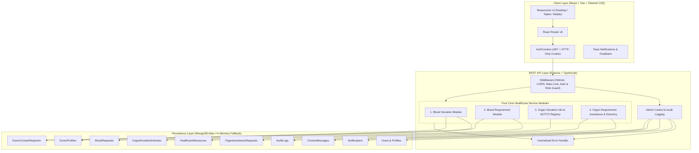

# JeevaLink — Healthcare & Community Support Platform

> **Tagline:** Connecting Lives. Inspiring Hope.  
> **Brand Colors:** Primary Blue (`#155EEF`), Healthcare Teal (`#0D9488`), Navy (`#101828`), Background (`#F7F9FC`)

---

## 1. Project Overview

**JeevaLink** is a full-stack, responsive, and secure healthcare and community assistance web application designed to connect people seeking blood donation assistance with potential voluntary donors, and to provide reliable organ donation information, official registration guidance, and transplant-resource navigation.

### The Four Core Healthcare Services:
1. **Blood Donation:** Voluntary donor registry, availability toggle, personal donation history, privacy-shielded donor discovery, and consent-guarded contact requests.
2. **Blood Requirement:** Urgent blood assistance request publishing with hospital details and urgency level, live fulfillment status tracking, and safe requester-donor contact channels.
3. **Organ Donation Information & Registration:** Public education on organ and tissue donation, brain-stem death, mandatory next-of-kin legal consent, verified links to official government registration channels (NOTTO/SOTTO), and a community expression-of-interest mechanism.
4. **Organ Requirement Information & Assistance:** Searchable directory of verified accredited transplant centres and government authorities, non-clinical assistance requests, and tracking with coordinator updates.

> **Ethical & Legal Compliance Notice:** JeevaLink strictly does **not** operate as an organ marketplace, determine medical eligibility, allocate organs, or replace hospitals, blood banks, or statutory healthcare systems.

---

## 2. Technology Stack

### Frontend
- **Framework & Language:** React 18 with TypeScript
- **Build Tool:** Vite
- **Styling:** Tailwind CSS (configured with JeevaLink brand colors)
- **Routing:** React Router v6
- **Icons:** Lucide React
- **Form Handling & Validation:** React Hook Form with Zod resolvers
- **Analytics & Charts:** Recharts
- **Notifications:** React Hot Toast

### Backend
- **Runtime & Framework:** Node.js with Express.js and TypeScript
- **Architecture:** Modular RESTful API (`/api/v1`)
- **Database ODM:** Mongoose (MongoDB Atlas / local MongoDB / zero-config in-memory MongoDB fallback)
- **Authentication & Security:** JWT, bcryptjs password hashing, HTTP-only secure cookies, Helmet security headers, CORS protection, express-rate-limit
- **Validation:** Zod schemas for all request payloads
- **Error Handling:** Centralized error handling middleware with custom `ApiError`

### Testing & Quality Assurance
- **Testing Framework:** Vitest
- **API Integration Tests:** Supertest with in-memory MongoDB isolation
- **Type Checking:** TypeScript strict compiler checks

---

## 3. System Architecture



---

## 4. Database Models Overview

| Model | Purpose | Key Attributes & Enums |
|---|---|---|
| **User** | Authentication & user account | `name`, `email` (unique), `password` (hashed), `phone`, `city`, `state`, `role` (`user`, `donor`, `requester`, `admin`), `termsAccepted` |
| **DonorProfile** | Voluntary blood donor profile | `user` (ref), `bloodGroup` (A+, A-, B+, B-, AB+, AB-, O+, O-), `isAvailable` (boolean), `contactPreference`, `lastDonationDate`, `consentToContact` |
| **BloodRequest** | Urgent blood assistance request | `requester` (ref), `hospital`, `bloodGroup`, `unitsRequested`, `unitsFulfilled`, `urgency` (`Normal`, `Urgent`, `Critical`), `status` (`Open`, `Contacting Donors`, `Partially Fulfilled`, `Fulfilled`, `Cancelled`, `Closed`) |
| **DonorContactRequest** | Privacy-shielded donor inquiry | `bloodRequest` (ref), `requester` (ref), `donor` (ref), `status` (`Pending`, `Accepted`, `Declined`), `sharedContactDetails` (released upon consent) |
| **OrganDonationInterest** | Community expression of interest | `user` (ref), `consentToSave`, `requestMoreInfo`, `isWithdrawn`, `submittedAt` (strictly non-legal registry) |
| **OrganAssistanceRequest** | Non-clinical guidance request | `user` (ref), `requesterName`, `assistanceType`, `briefDescription`, `status` (`Submitted`, `Under Review`, `Information Required`, `Referred to Resource`, `Resolved`, `Cancelled`), `adminNotes` |
| **HealthcareResource** | Verified directory of accredited institutions | `name`, `category` (Government Authority, Transplant Center, Blood Center, Cornea Bank), `city`, `state`, `sourceReference`, `isVerified`, `lastVerifiedDate` |
| **Notification** | Real-time in-app user notifications | `recipient` (ref), `title`, `message`, `type`, `linkUrl`, `isRead`, `readAt` |
| **ContactMessage** | Public support submissions | `fullName`, `email`, `subject`, `message`, `status` (`New`, `Under Review`, `Replied`, `Closed`) |
| **AuditLog** | Administrative and security audit trail | `actor` (ref), `actorEmail`, `actorRole`, `action`, `targetType`, `targetId`, `ipAddress`, `createdAt` |

---

## 5. API Endpoints Reference

All routes are versioned under `/api/v1`.

### Authentication & Profile
- `POST /api/v1/auth/register` — Register a new user account
- `POST /api/v1/auth/login` — Sign in and issue session token / cookie
- `POST /api/v1/auth/logout` — Clear session
- `GET /api/v1/auth/me` — Get authenticated user details
- `PATCH /api/v1/users/me` — Update profile information

### Service 1 — Blood Donation
- `GET /api/v1/donors` — Search donors by bloodGroup, city, state, availability (phone hidden)
- `POST /api/v1/donors` — Register / update current user as a donor
- `GET /api/v1/donors/me` — Get caller's donor profile
- `PATCH /api/v1/donors/me` — Update donor profile details
- `PATCH /api/v1/donors/me/availability` — Toggle availability status
- `POST /api/v1/donors/me/donation-history` — Record a donation entry
- `POST /api/v1/donors/me/withdraw` — Withdraw donor listing from public discovery

### Service 2 — Blood Requirement
- `GET /api/v1/blood-requests` — Browse public active blood requests
- `POST /api/v1/blood-requests` — Create a new blood request
- `GET /api/v1/blood-requests/me` — Get requester's requests and dashboard metrics
- `GET /api/v1/blood-requests/:id` — Get single request details
- `PATCH /api/v1/blood-requests/:id` — Update status / units fulfilled
- `POST /api/v1/blood-requests/:id/cancel` — Cancel a blood request

### Donor Contact Requests (Privacy Workflow)
- `POST /api/v1/donor-contact-requests` — Requester contacts a consented donor
- `GET /api/v1/donor-contact-requests/incoming` — Donor views incoming inquiries
- `GET /api/v1/donor-contact-requests/outgoing` — Requester tracks contact statuses
- `PATCH /api/v1/donor-contact-requests/:id/respond` — Donor accepts or declines

### Service 3 — Organ Donation Information & Registration
- `GET /api/v1/organ-donation/resources` — Get verified official external portals (NOTTO, ROTTO, SOTTO)
- `GET /api/v1/organ-donation/faq` — Educational FAQs (living vs deceased, legal consent, myths vs facts)
- `POST /api/v1/organ-donation/interest` — Submit JeevaLink community expression of interest
- `GET /api/v1/organ-donation/interest/me` — Get user's expression of interest
- `POST /api/v1/organ-donation/interest/withdraw` — Withdraw expression of interest

### Service 4 — Organ Requirement Assistance & Directory
- `GET /api/v1/healthcare-resources` — Search verified hospitals, transplant centers, and blood banks
- `GET /api/v1/healthcare-resources/:id` — Get details of a resource
- `POST /api/v1/organ-assistance-requests` — Submit non-clinical assistance request
- `GET /api/v1/organ-assistance-requests/me` — View caller's assistance requests & admin notes
- `POST /api/v1/organ-assistance-requests/:id/cancel` — Cancel assistance request

### Notifications & Contact
- `GET /api/v1/notifications` — Fetch user's in-app notifications & unread count
- `PATCH /api/v1/notifications/:id/read` — Mark notification as read
- `PATCH /api/v1/notifications/read-all` — Mark all notifications as read
- `POST /api/v1/contact` — Submit public contact message

### Protected Admin Controls (`/api/v1/admin/*`)
- `GET /api/v1/admin/dashboard` — Live database counts, blood group stats, request status breakdowns
- `GET /api/v1/admin/users` — List and manage user accounts
- `PATCH /api/v1/admin/users/:id/role` — Update user account role
- `GET /api/v1/admin/donors` — Master donor registry view
- `GET /api/v1/admin/blood-requests` — All blood requests management
- `GET /api/v1/admin/organ-assistance-requests` — All assistance inquiries
- `PATCH /api/v1/admin/organ-assistance-requests/:id` — Update status, add coordinator notes
- `POST /api/v1/admin/resources` — Create verified healthcare institution
- `PATCH /api/v1/admin/resources/:id` — Edit verified resource
- `DELETE /api/v1/admin/resources/:id` — Remove verified resource
- `GET /api/v1/admin/contact-messages` — View and manage support messages
- `GET /api/v1/admin/audit-logs` — Complete system audit trail

---

## 6. Getting Started & Installation

### Prerequisites
- **Node.js:** v18.0.0 or higher (Tested on v22.17.0)
- **NPM:** v9.0.0 or higher
- **MongoDB (Optional):** If no remote or local MongoDB instance is running, JeevaLink **automatically initializes a local in-memory MongoDB instance** for zero-friction development!

### 1. Clone & Install Dependencies

```bash
# Clone the repository
git clone <repo-url> jeevalink
cd jeevalink

# Install root dependencies
npm install

# Install backend dependencies
cd backend && npm install

# Install frontend dependencies
cd ../frontend && npm install
cd ..
```

### 2. Environment Configuration

Copy the example environment files:

```bash
# Backend configuration
cp backend/.env.example backend/.env

# Frontend configuration
cp frontend/.env.example frontend/.env
```

#### Backend `.env` Options:
```env
PORT=5000
NODE_ENV=development

# Leave empty for automatic in-memory MongoDB, or provide Atlas/local URI
MONGODB_URI=

JWT_SECRET=jeevalink_super_secure_jwt_secret_key_2025_safe_token_generator
JWT_EXPIRES_IN=7d
FRONTEND_URL=http://localhost:5173

# Default Admin Credentials
ADMIN_NAME=JeevaLink Administrator
ADMIN_EMAIL=admin@jeevalink.org
ADMIN_PASSWORD=AdminSecurePass123!
```

### 3. Seed Default Administrator (Optional)

```bash
npm run seed:admin
```

This ensures an administrator account (`admin@jeevalink.org` / `AdminSecurePass123!`) is provisioned.

### 4. Run Development Servers

Run both frontend and backend concurrently from the root directory:

```bash
npm run dev
```

- **Frontend:** [http://localhost:5173](http://localhost:5173)
- **Backend API:** [http://localhost:5000/api/v1](http://localhost:5000/api/v1)
- **API Health Check:** [http://localhost:5000/api/v1/health](http://localhost:5000/api/v1/health)

---

## 7. Running Automated Tests

Run the comprehensive integration test suite covering authentication, donor workflows, blood requests, organ services, and admin route protection:

```bash
# Run backend integration tests
npm test
```

Test results:
- `auth.test.ts`: Registration, duplicate check, login, password validation, protected `/me` (6/6 tests passing)
- `bloodWorkflow.test.ts`: Donor registration, availability toggle, blood request lifecycle, contact requests, donor consent release (1/1 multi-step workflow test passing)
- `organServices.test.ts`: Public organ resources & FAQs, expression of interest submit & withdraw, organ assistance lifecycle & admin authorization (3/3 tests passing)
- **Total:** 10/10 tests passed.

---

## 8. Security & Privacy Safeguards

1. **Donor Privacy Protection:** Donor phone numbers and personal emails are never exposed to anonymous visitors or public searches. Contact details are released exclusively when a donor explicitly accepts an incoming inquiry.
2. **Password Security:** Salted hashes generated using bcryptjs with a cost factor of 10. Passwords are never stored or logged in plain text.
3. **Session Authentication:** Signed JWT tokens delivered via HTTP-only secure cookies with an `Authorization: Bearer` fallback.
4. **Backend Authorization:** Route-level role enforcement (`requireRole('admin')`) and resource-level ownership validation on every mutate operation.
5. **Anti-Brute-Force Rate Limiting:** Rate limiters applied on all endpoints (`1000 req/15min`) and strict rate limiting on authentication routes (`50 req/15min`).
6. **Audit Logging:** Every sensitive administrative action, status update, and role change is permanently recorded in the `AuditLog` collection.
7. **Input Validation:** Strict schema validation on all incoming payloads using Zod.

---

## 9. Known Limitations & Future Roadmap

- **External Government Integration:** Direct electronic integration with the NOTTO database requires official API partnership with the National Health Authority (NHA). JeevaLink currently directs users to verified official NOTTO portals.
- **SMS / Push Delivery:** Notifications are currently delivered via real-time MongoDB in-app notification center. SMS integration (e.g. via Twilio or Indian DLT gateways) can be plugged in when provider credentials are configured.
- **Hospital EMR Integrations:** Blood requests are created by authenticated patient representatives or hospital liaisons; HL7/FHIR integration can be added in subsequent enterprise releases.

---

## 10. License

Developed with care for community healthcare support. Open source under the MIT License.
